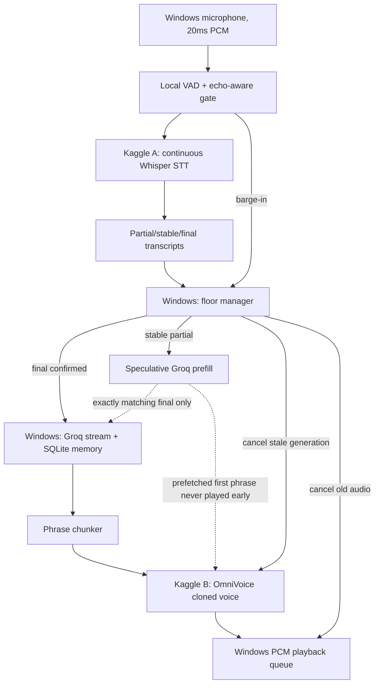

# Jarvis Research Build: Continuous Full-Duplex Windows + Two Kaggle Services

> **Status:** Code and ordered notebooks are committed. Offline syntax/policy checks exist. This has NOT been tested end-to-end against your two live Kaggle accounts, actual microphone, private voice dataset or Groq credentials. It is a research implementation, not a proven human-equivalent speech model.

## Quick-start (three devices/services)

### 1 — Kaggle A: Ear, continuous STT

Open [Jarvis_Kaggle_A_Continuous_STT.ipynb](notebooks/Jarvis_Kaggle_A_Continuous_STT.ipynb), enable one GPU and Internet. In **Add-ons → Secrets** create `STT_WS_TOKEN` (random 24+ characters), enable notebook access. Run every notebook cell in order. Verify `/health` then copy the resulting `STT_WS_URL=wss://.../stt` to Windows.

The STT notebook does **not** need a voice dataset, Groq credentials, or OmniVoice.

### 2 — Kaggle B: Voice, cloned TTS

Open [Jarvis_Kaggle_B_OmniVoice_TTS.ipynb](notebooks/Jarvis_Kaggle_B_OmniVoice_TTS.ipynb) in a separate, legitimate Kaggle session/account and enable a GPU and Internet. Give that account authorized access to the private dataset containing:

- `jarvis_en/new-ref.mp3` and `jarvis_en/ref.txt`
- `jarvis_ta/ref.mp3` and `jarvis_ta/ref.txt`

In its Kaggle Secrets, create **`TTS_WS_TOKEN`**, different from the STT token. Run all cells, listen to the **English and Tamil standalone audio tests**, then copy `TTS_WS_URL=wss://.../tts` to Windows. TTS runs on **GPU index 0** in its OWN session; never configure GPU 1 unless that session actually exposes two devices.

### 3 — Windows: Local conversation coordinator + Groq

In PowerShell:

```powershell
cd C:\Users\LENOVO\jarvis-realtime-voice
git pull --ff-only
.\.venv\Scripts\python.exe -m pip install -r requirements-realtime-windows.txt
if (-not (Test-Path .env)) { Copy-Item realtime_windows.env.example .env }
notepad .env
```

If an existing `.env` contains older configuration, **add** the new keys instead of overwriting your existing values. Update these entries with your own real credentials (never paste keys into a chat or GitHub):

```dotenv
STT_WS_URL=wss://actual-stt-tunnel.trycloudflare.com/stt
STT_WS_TOKEN=your-private-stt-token
TTS_WS_URL=wss://actual-tts-tunnel.trycloudflare.com/tts
TTS_WS_TOKEN=your-different-private-tts-token
GROQ_API_KEY=your-private-free-tier-key
GROQ_MODEL=openai/gpt-oss-20b
LLM_BACKEND=groq
HEADPHONES=1
ENABLE_PREFILL=1
ENABLE_BACKCHANNELS=1
```

Get Groq key at https://console.groq.com/keys and use only on Windows. The Kaggle notebooks do not need this key.

Start Jarvis:

```powershell
.\.venv\Scripts\python.exe realtime_jarvis.py
```

Expected messages:

```text
[network] Both Kaggle sessions connected
[stt] connected: 16000 Hz
[tts] connected: 16000 Hz
[partial-stable] ...
[final] ... | ASR=...ms
[prefill] ...
[speak 0] ...
[tts] seg=0 compute=...ms audio=...ms
[latency] speech-end-to-audio-callback=...ms
```

The reported callback value is the first PCM issued to Windows' audio callback; it is a much better proxy for audible response than the old server-side `first_pcm_after_commit_ms`, but it still does not account for the speaker's acoustic output delay.

## Architecture



### What's implemented

- Two separate **authenticated, persistent WebSockets**; no direct Kaggle A-to-B network dependency
- Continuous local 20ms microphone frames, rolling faster-whisper partials and LocalAgreement-2 style stabilized text
- English/Tamil allowed-language fallback and confidence filtering (still imperfect on Tanglish)
- Adaptive end-of-turn thresholds, optional Smart Turn completion probability (disabled by default until ONNX weights verified)
- Local Groq streamed tokens, phrase-at-a-time OmniVoice synthesis; persists recent dialogue to local SQLite
- **Speculative prefill**: on sufficiently stable partial user text, Windows begins a Groq response and asks TTS to pre-generate its first phrase. It **never** plays until the final transcript is an exact normalized match. A changed hypothesis cancels/discards the speculative answer.
- Two short **backchannels** prefetched on TTS ("Mm-hmm.", "சரி.") and emitted sparingly when the user is talking for several seconds and briefly pauses. No repeated synthetic "ayyo" or habit tags.
- **Barge-in**: headphones recommended; local microphone keeps running while speaker plays, auto-ducks speaker on suspected overlap and cancels the previous Groq/TTS task for substantive interruptions. Short acknowledgments should continue rather than hijack the floor.
- Turn IDs, segment IDs, bounded TTS task queue, obsolete-turn dropping; no stale audio after a new turn
- Network retry loop; reloads `.env` so updated Quick Tunnel URLs can take effect without restarting Windows program
- Actual Windows first-audio-callback timing metric

### Tunable settings

| Variable | Side | Initial value | Purpose |
| --- | --- | --- | --- |
| `STT_MODEL` | Kaggle A | `medium` | Switch to `large-v3` if accuracy matters more than speed/VRAM |
| `ASR_LANGUAGE` | Kaggle A | `auto` | Use `en` or `ta` for single-language test |
| `STT_PARTIAL_INTERVAL` | Kaggle A | `0.55` | Partial ASR cadence in seconds |
| `SMART_TURN_ENABLED` | Kaggle A | `0` | Requires validated ONNX runtime/weights |
| `OMNIVOICE_STEPS` | Kaggle B | `12` | Fewer decoding steps can be faster but reduce quality |
| `OMNIVOICE_SPEED` | Kaggle B | `1.0` | **Native TTS speaking speed** (not fake WAV sample rate) |
| `ENABLE_PREFILL` | Windows | `1` | Speculative Groq + first TTS phrase |
| `ENABLE_BACKCHANNELS` | Windows | `1` | Rare spoken acknowledgments |
| `FORCE_BARGE_MS` | Windows | `850` | Speaker yields if a likely human speaks this long |
| `AEC_ENABLED` | Windows | `0` | Optional software AEC; requires compatible package |
| `HEADPHONES` | Windows | `1` | Set 0 to disable backchannels until audio feedback fixed |

For lower pitch, adjust OmniVoice's documented `OMNIVOICE_SPEED` if you want longer-duration speech. **Don't transmit 16 kHz PCM while falsely labelling it as 13.5 kHz.** It breaks client timing; pitch/timbre changes are better handled through voice generation or correct resampling.

## Research basis

1. Veluri et al. (EMNLP 2024), [Beyond Turn-Based Interfaces: Synchronous LLMs as Full-Duplex Dialogue Agents](https://aclanthology.org/2024.emnlp-main.1192/). Motivates concurrent listening, timing and backchannel support.
2. Zhang et al. (2025, updated 2026), [LLM-Enhanced Dialogue Management for Full-Duplex Spoken Dialogue Systems](https://arxiv.org/abs/2502.14145). Separates turn-taking control from slower main response generation.
3. Macháček et al. (2023), [Turning Whisper into Real-Time Transcription System](https://aclanthology.org/2023.ijcnlp-demo.3/). LocalAgreement-2 stable partial approach; plain Whisper isn't a true streaming encoder.
4. [Pipecat Smart Turn v3.2](https://github.com/pipecat-ai/smart-turn). Audio-based end-of-turn detection beyond fixed silence.
5. Lin et al. (2025), [Full-Duplex-Bench](https://arxiv.org/abs/2503.04721). Validate pause handling, backchannels, interruptions and floor changes independently.
6. Paierl et al. (Interspeech 2025), [Continuous Prediction of Backchannel Timing](https://www.isca-archive.org/interspeech_2025/paierl25_interspeech.pdf). Speaking duration, intensity and pitch can improve backchannel timing; current implementation uses cautious duration/cooldown heuristics pending acoustic model.
7. [OmniVoice model documentation](https://github.com/k2-fsa/OmniVoice/blob/master/docs/generation-parameters.md). Documents native speed and decoding-step controls.

**This is an engineered approximation inspired by the papers, not a trained synchronous audio-native model or a reproduction of their reported benchmark performance.**

## Acceptance tests (must be run on real hardware)

1. Speak 5 minutes naturally (English, Tamil, mixed); check partial revisions vs final and note hallucinations/word-error rate.
2. While Jarvis talks, say "hmm" — it should continue and not restart the reply.
3. Interrupt with "Wait, that's not what I meant" — playback should duck quickly, old queued speech canceled, and fresh answer generated.
4. Speak long sentences with pauses ("I want to… actually…"); ensure short thinking pauses don't split turns.
5. Confirm Groq is called **from Windows only**; no `GROQ_API_KEY` in Kaggle Secrets.
6. Run the English/Tamil cloned-voice test from the second notebook and listen to the complete last sentence.
7. Review `[latency]` for speech-end-to-audio callback, log p50/p95, first LLM token and TTS synthesis time. **No subsecond latency claim until measured.**
8. Restart either Kaggle notebook; update that service's WSS URL in Windows `.env` and verify automatic reconnection.

### Limitations

- Whisper Medium is re-decoding rolling audio on Kaggle rather than a purpose-trained causal streaming ASR, so partial latency and Tamil/Tanglish accuracy remain imperfect.
- OmniVoice still generates each short phrase before sending its PCM chunks; this is **not** native incremental audio-token synthesis. Warm/cached first phrases help only when speculation succeeds.
- Voice activity detection and short-utterance heuristics are not sufficient to guarantee perfect semantic turn-taking. Smart Turn is opt-in pending model setup and benchmarking.
- Stable partial exact-match prefill can waste Groq usage and GPU cycles if final text differs; turn it off with `ENABLE_PREFILL=0` if rate-limited.
- Cloudflare Quick Tunnels are **temporary** and Kaggle notebooks are time-limited (documented notebook sessions typically capped), so this is experimental infrastructure rather than an always-on assistant. Do not use multiple Kaggle accounts to evade account quotas or platform policies.
- With laptop speakers and no working AEC, feedback will trigger fake "user speech." **Start with headphones.**
- Cancellation while OmniVoice is inside a GPU kernel cannot instantaneously stop the kernel; old audio is rejected, but a new synthesis may have to wait for the old computation to release the GPU.
